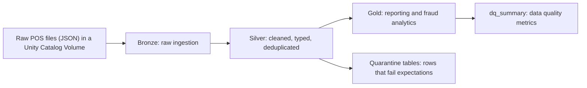

# Applebee's POS Medallion Pipeline

An end-to-end **fraud-detection and sales-analytics data pipeline** for Applebee's point-of-sale (POS) data, built on **Databricks Lakeflow Declarative Pipelines** with a **medallion (bronze / silver / gold) architecture** and governed by **Unity Catalog**.

It turns millions of raw POS records (~28.5M item lines, ~2.1M checks) into trustworthy daily reporting and flags suspicious employee behavior: cash voids, self-approved discounts, payment discrepancies and tip outliers.

---

## Architecture



| Setting | Value |
|---|---|
| Platform | Databricks Lakeflow Declarative Pipelines (Delta Live Tables) |
| Governance | Unity Catalog, catalog `applebees` |
| Compute | Serverless, Photon enabled |
| Mode | Triggered (batch-style), scheduled daily at 2:00 AM (America/Mexico_City) |
| Ingestion | Auto Loader (incremental) |
| Size | 27 tables |

---

## Repository structure

```
.
├── README.md
├── resources/
│   ├── jobs/
│   │   └── daily_orchestration_job.yml          # Daily job: schedule and task
│   └── pipelines/
│       └── applebees_pos_medallion_pipeline.yml # Pipeline configuration
└── src/
    └── transformations/
        ├── bronze/01_bronze.py                  # Raw ingestion
        ├── silver/02_silver.py                  # Cleaning, typing, quarantine
        └── gold/
            ├── 03_gold.py                       # Business analytics and fraud detection
            └── 04_dq.py                         # Data quality summary
```

Orchestration lives in `resources/`, table logic lives in `src/transformations/`.

---

## Data layers

**Bronze (raw ingestion).** `bronze_checks` is a streaming table with one row per POS check, keeping the nested JSON structure (items, payments, discounts, tax, voids). It is ingested **incrementally with Auto Loader**: only new `dt=YYYY-MM-DD` files are processed. Small dimensions (employees ~157K, items ~17K, locations 185, revenue centers 23) are fully refreshed on every update.

**Silver (cleaned and organized).**

| Table | Description |
|---|---|
| `silver_checks` | One row per valid check, with parsed timestamps and computed totals (~2.1M rows) |
| `silver_check_items` | One row per item line (~28.5M rows), liquid clustered |
| `silver_item_discounts` / `silver_check_discounts` | Discounts with approver vs. manager context and a **self-approved** flag |
| Quarantine tables | Rows that fail expectations are parked here, never dropped |

**Gold (business answers).**

| Table | What it answers |
|---|---|
| `gold_daily_sales` | Daily sales per location (core reporting) |
| `gold_payment_discrepancies` | Checks where item totals do not match payments |
| `gold_cash_void_discount_checks` | Cash-paid checks with voids or discounts (classic cash-fraud pattern) |
| `gold_discount_abuse` | Discount usage per employee, with self-approved isolation |
| `gold_tip_outliers` | Employees with gratuity rates more than 2σ above their location mean |
| `gold_employee_risk` | Composite z-scored risk score (0 to 6 flags) per employee vs. same-location peers |
| `dq_summary` | Row counts and data quality violations per rule |

---
## Results and insights

### Pipeline run (latest validated run)

| Metric | Value |
|---|---|
| Status | Completed, 0 errors, 0 warnings |
| Tables produced | 27 |
| Duration | ~2.5 minutes |
| Checks / item lines processed | ~2.1M / ~28.5M |
| Rows quarantined in latest run | 3 checks |

### What the data revealed

- **Data quality is high.** Only 3 check rows were quarantined out of ~2.1M, so the source data is structurally clean.
- **Payment discrepancies are widespread.** About 2M checks show a mismatch between item totals and payments. Such a high share suggests a *systematic* effect (for example how tax, tips or rounding are recorded) more than millions of independent incidents. The pipeline keeps all of them unfiltered so the root cause can be investigated.
- **Fraud signals are separated by type.** Cash voids/discounts, self-approved discounts, tip outliers and payment mismatches each have their own gold table, and `gold_employee_risk` combines them into a single ranking.

---

## How to review this repository

1. Read the code in layer order: `01_bronze.py` (its docstring explains the ingestion strategy), `02_silver.py`, `03_gold.py`, `04_dq.py`.
2. Check the configuration in `resources/pipelines/` and `resources/jobs/`.
3. Optional, in Databricks: open the pipeline graph to see the 27 tables and their lineage.

> The raw dataset is **not included** in this repository. It lives in a Unity Catalog Volume in the Databricks workspace.

## How to run it

**Prerequisites:** a Databricks workspace with Unity Catalog, serverless compute, and the raw POS files available in a Volume.

1. **Import the repo:** *Workspace → Create → Git folder*, and paste this repository's URL.
2. **Prepare the data:** make the raw files available at `/Volumes/applebees/data/dataset/` (checks as `dt=YYYY-MM-DD` JSON array files plus the employee, item, location and revenue center JSON files). The path is set by `SOURCE_VOLUME` in `01_bronze.py`.
3. **Create the pipeline:** *Jobs & Pipelines → Create → ETL pipeline*. Set the catalog to `applebees`, enable serverless, and add `src/transformations/**` as the source code path (see `resources/pipelines/applebees_pos_medallion_pipeline.yml`).
4. **Run it:** click *Run pipeline*. Use *Dry run* first to validate without processing data.
5. **Schedule it (optional):** create a Job with a pipeline task pointing at the pipeline (see `resources/jobs/daily_orchestration_job.yml`).

Do not use *Full refresh* for routine runs: `bronze_checks` is incremental and a full refresh reprocesses all history.

---